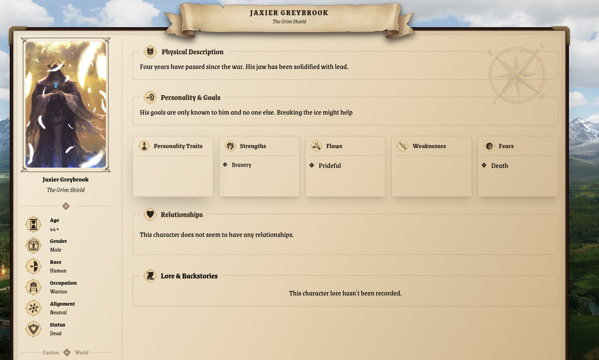
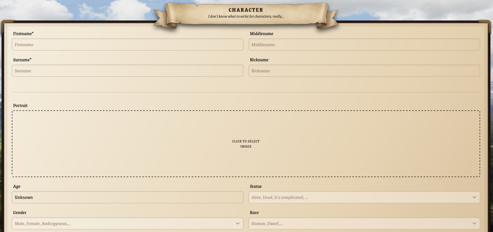

# README FABLEBOUND

## About

Fablebound is a small personal app made with the intent to help making TTRPG/Story driven character, stories and places.
It is a small application made using [Wails](https://v3.wails.io/), a cross-platform framework using Golang backend and anything you want for the front.

## What is used?
- Wails:
  - Golang with SQLite
  - Svelte + Tailwind + Homemade CSS
- Basic MVC + CRUD
- A WYSIWYG text editor with TipTap

## What's missing?
- A kanban or project overview (didn't make one 🧐)
- CI/CD

## Next to do
-[ ] CI/CD with github actions
-[ ] Unit tests for CI/CD
-[ ] Improve performance (Wails v3 issue maybe?)
-[ ] Add external SQL connection + security.
-[ ] And much more.

## What's done
-[x] Basic CRUD with GORM
-[x] MVC (Not perfect, but it's working and enjoyable I think?)
-[x] Views and General Overviews
-[x] WYSIWYG Text Editor - Acting as a reader too.
-[x] Router (Homemade with regex because the external modules were not working)
